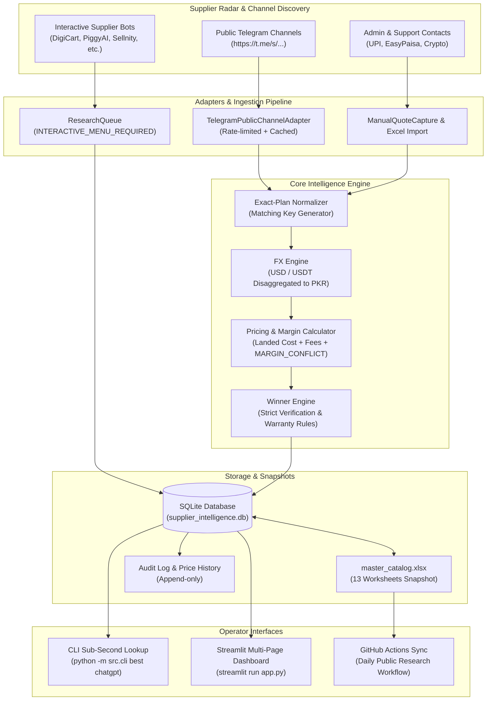

# AI Tool Gems — Supplier Price Intelligence & Procurement System

**Classification:** STRICTLY CONFIDENTIAL — Internal Wholesale Sourcing Intelligence  
**Target Business:** AI Tool Gems Pakistan ([aitoolgems.tech](https://aitoolgems.tech/))  
**Repository:** `m-rehman55/ai-tool-gems-supplier-intelligence` (Private)

---

## 1. System Overview & Architecture

This system automates wholesale pricing intelligence across 45+ Telegram supplier bots, public channels, and supplier matrices. It eliminates manual 15-minute quote lookups by providing **sub-second best-price queries** (`python -m src.cli best <tool>`) and a comprehensive **Streamlit Management Dashboard**.

### Architecture Workflow



---

## 2. Directory Structure

```text
ai-tool-gems-supplier-intelligence/
├── .github/
│   └── workflows/
│       ├── ci.yml                     # Pytest suite & coverage enforcement
│       └── daily-public-research.yml  # Daily automated public crawler & Excel commit
├── data/
│   ├── backups/                       # Timestamped database snapshots
│   ├── cache/telegram/                # Cached public HTML previews
│   ├── seed/                          # Raw initial scraper outputs
│   └── supplier_intelligence.db       # Transactional SQLite runtime database
├── src/
│   ├── adapters/
│   │   ├── __init__.py
│   │   └── public_telegram.py         # Public channel parser (no-login preview)
│   ├── __init__.py
│   ├── alerts.py                      # Risk, stale quote, and price drop detector
│   ├── cli.py                         # Operational command-line interface
│   ├── config.py                      # Central settings & FX benchmark defaults
│   ├── database.py                    # SQLAlchemy session & transaction management
│   ├── excel.py                       # 13-sheet master_catalog.xlsx generator
│   ├── fx.py                          # FX rate engine (USD/USDT to PKR)
│   ├── matching.py                    # Exact-plan matcher & matching key generator
│   ├── models.py                      # 10 core relational database entities
│   ├── pricing.py                     # Landed cost & margin calculator
│   └── seed_data.py                   # Canonical directory of 45+ supplier leads
├── tests/
│   ├── test_adapters.py               # HTML parsing fixtures & cache tests
│   ├── test_alerts.py                 # Risk & stale alert tests
│   ├── test_database.py               # DB persistence & conflicting quote tests
│   ├── test_excel.py                  # 13-sheet workbook export validation
│   ├── test_fx.py                     # FX rates & USDT disaggregation tests
│   ├── test_matching.py               # Normalization & matching key tests
│   └── test_pricing.py                # Landed cost & margin conflict tests
├── .env.example                       # Environment template (no secrets)
├── .gitignore                         # Secret, DB, and cache exclusion
├── app.py                             # 10-page Streamlit operator dashboard
├── DATA_DICTIONARY.md                 # Schema definitions & exact-match rules
├── IMPLEMENTATION_STATUS.md           # Milestone & test tracking record
├── master_catalog.xlsx                # Single persistent 13-sheet Excel workbook
├── pyproject.toml                     # Pytest & package build config
├── requirements.txt                   # Pinned dependency requirements
├── README.md                          # Master documentation & user guide
└── SECURITY.md                        # Compliance, private repo & risk rules
```

---

## 3. Quickstart & Installation (Windows PowerShell)

### Prerequisites:
- Python 3.11+ (Python 3.12 recommended)
- Git & PowerShell

### Step 1: Clone & Setup Virtual Environment
```powershell
cd d:\Desktop\ai-tool-gems-supplier-intelligence
python -m venv .venv
.\.venv\Scripts\Activate.ps1
pip install -r requirements.txt
```

### Step 2: Initialize Database & Seed 45+ Suppliers
```powershell
python -m src.cli init
```

### Step 3: Verify Test Suite (21 Tests, 100% Pass)
```powershell
pytest --cov=src tests -v
```

---

## 4. Operational CLI Commands

| Command | Execution Time | Purpose |
|---|---|---|
| `python -m src.cli best <tool>` | **0.2 seconds** | Instant lowest-cost lookup for WhatsApp client queries |
| `python -m src.cli init` | 2 seconds | Re-initializes database and seeds canonical directory |
| `python -m src.cli export-workbook` | 1 second | Exports single persistent `master_catalog.xlsx` (13 sheets) |
| `python -m src.cli research --public-only`| ~10 seconds | Crawls public channels without credentials or login |
| `python -m src.cli alerts` | < 1 second | Displays active risk alerts, stale quotes, and price shifts |
| `python -m src.cli backup` | < 1 second | Creates a timestamped snapshot of `supplier_intelligence.db` |

### Example CLI Output (`best chatgpt`):
```text
====================================================================================================
AIToolGems Supplier Radar -- Best Quotes for: chatgpt
====================================================================================================

[PLAN 1/5] chatgpt__chatgpt_plus__1_month__private
   Category: AI Assistant | Duration: 1 Month | Access: PRIVATE
   Status: No verified winner yet (Showing unverified candidate leads)
   * Candidate 1: DigiCart Tools (@getdigitaltools_bot)
     Cost: $5.00 USD (Rs. 1,400 PKR) | Warranty: Full Warranty (FW)
     Status: USER_SUPPLIED_UNVERIFIED | Stock: In Stock
     Landed Cost: Rs. 1,463 PKR | Suggested Retail: Rs. 2,100 PKR (Profit: +Rs. 637 PKR)
     Order Link: https://t.me/getdigitaltools_bot
```

---

## 5. Streamlit Dashboard Guide

Launch the local private dashboard:
```powershell
streamlit run app.py
```

### 10 Integrated Pages:
1. **Overview:** Total suppliers, exact plans, active quotes, risk metrics, and quick stat counters.
2. **Supplier Directory:** Search 45+ suppliers with status tags, direct links, and supported payment methods.
3. **Products & Plans:** Browse distinct exact plans and check matching keys.
4. **Price Comparison:** Side-by-side supplier table for each plan with landed costs and margins.
5. **Quote History:** Append-only timeline showing price drops, hikes, and warranty changes.
6. **Research Queue:** Track interactive bots needing manual `/start` and review queue items.
7. **Manual Quote Entry:** Rapid quote capture form with instant landed cost calculation.
8. **Retail & Profit Calculator:** Interactive margin simulator with `MARGIN_CONFLICT` detection.
9. **Import / Export:** One-click Excel (`master_catalog.xlsx`) and JSON export/import.
10. **Settings & Alerts:** Live feed of high-risk offers, stale quotes, and FX configurations.

---

## 6. Verification & Safety Policy

- **`VERIFIED` Status:** Only awarded when an inspectable public post link or verified payment screenshot is recorded within the freshness window (48 hours).
- **Conflict Preservation:** Conflicting claims from different sources (e.g., $0.42 vs $0.45 for Gemini 18M) are preserved as separate unverified observations. History is never overwritten.
- **USDT vs USD:** Distinct exchange rates (280.0 USD vs 282.5 USDT) are tracked separately to prevent currency confusion.
